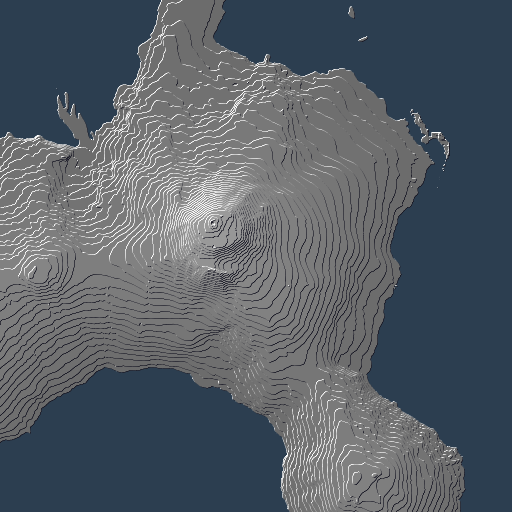
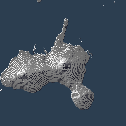

# 01: Burns from a raster (isobands, isolines, Tanaka)

Tries the "Burns from rasters" section of `../../README.md`. It makes the
band burn of a raster cell by cell, on the dual grid, and checks it against
GDAL's and isoband's whole-raster contour polygons, each burned by
controlledburn. It then checks that tiles and pyramid levels behave as the
notes claim, and renders Tanaka contours from the tables.

- `bands.R`: the band burn, in plain vectorised R. It takes a cell's four
  corner values and returns its band fractions and isoline lengths. It
  clips the cell against each level it straddles (linear on the walls,
  straight chords between the crossings, as in marching squares). It also
  holds Tanaka weights, the pyramid and contour-interval group-bys, and the
  renderer.
- `run.R`: the checks on `volcano` and on a REMA 100 m window around Mt
  Erebus, the tiles, the pyramid and the renders. Output is in
  `results.txt`.
  - `Rscript run.R <outdir> [rema_100m_dem.tif]`. The REMA path defaults
    to `raadtools::topofile("rema_100m")`.
- `scale.sh` and `scale.R`: one 8193 × 8193 REMA window. The band burn by
  tiles in parallel is set against GDAL's whole-raster polygons and lines,
  burned by controlledburn. Output is in `scale.txt`.
  - `./scale.sh <outdir> [cores]`.

Versions: controlledburn 0.3.2.9000 (the R package), GDAL
3.14.0dev-fedfd3ec89 (`gdal raster contour`), isoband 0.3.0.

## Results (2026-11-23)

Erebus window: 1025 × 1025 pixels, with nodata (ocean) filled with −100 m,
so that every method sees one surface. 75 levels, 0 to 3700 m by 50. Its
dual grid has 1024 × 1024 cells.

- **The cell-local burn equals the burn of GDAL's polygons:**
  - all 1,167,018 records agree to 6e-8, which is f32;
  - GDAL builds those polygons by joining segments and nesting rings
    across the whole raster. The band burn does neither.
- **Lines equal the burn of GDAL's contour lines** to 2e-7 of a cell.
  GDAL has 2 more records, each about 1e-5 m long, where a corner value
  equals a level exactly (see "GDAL's fudge" below).
- **The saddle rule is the only difference between GDAL and isoband:**
  - with the "mean" rule (isoband's), the burn equals isoband's polygons
    to f32;
  - the "gdal" and "mean" burns differ in 28 records, all in 14 saddle
    cells (38 saddle pairs of cell and level, out of 1M cells).
- **No negative fractions:** at each level the region above contains the
  region above the next level up, under both rules.
- **Bands partition each cell** to within the 1e-6 threshold.
- **Tiles are independent.** 16 tiles of 256 × 256, each burned from its
  own window with a one-pixel halo, give exactly the whole burn, with no
  stitching.
- **The pyramid is a group-by.** Summing the 100 m burn by
  `(row %/% f, col %/% f, id)` equals the burn of GDAL's polygons and
  lines onto the coarse grid directly, for f = 2, 4 and 8 (to 3e-7).
  GDAL's extra fudge lines show up once more in the lines record counts.
- **The contour interval is a group-by on id.** `merge_levels()` keeps a
  subset of the levels: bands merge by summing fractions, and lines are
  filtered by id. The renders use this to go from 50 m to 100 m and to
  200 m.
- **Speed (one thread, R):** the band burn takes 2.2 s. GDAL's polygons
  take 0.25 s and the controlledburn burn of them 0.22 s. Plain R is not
  a fair match for C++; see the scaling results for tiles in parallel.

### Tanaka

`tanaka_weights()` uses each dual cell's mean gradient, from its four
corners. It splits each line record's length into lit and shaded weights,
length × |cos θ|, for light from the north-west (azimuth 315°, in grid
north). The renderer needs no stroking:

- the band fractions give the tint;
- the ink in a cell is weight × stroke width / cell area, clamped at 1.
  That is the coverage of a stroke of that width, to the extent that the
  strokes are narrower than the cell.

| 100 m cells, 100 m interval (crop around the summit) | 400 m cells, 200 m interval, by group-by |
|---|---|
|  |  |

The 400 m render is made from the 100 m burn alone: the cells and weights
by group-by, then the interval by group-by on id. Nothing was contoured
again.

### Scaling (`scale.txt`)

The window is REMA 100 m, 8193 × 8193 pixels: x 0 to 819 km and y −980
to −1800 km in EPSG:3031. It covers Ross Island, the Royal Society
Range, the Dry Valleys and the edge of the plateau. It is 70% valid, and
nodata is filled with −100. 91 levels, 0 to 4500 m by 50. The dual grid
has 67M cells.

| route | time | peak memory |
|---|---|---|
| GDAL polygons, whole raster, one thread | 23.6 s | 0.8 GB |
| GDAL lines, whole raster, one thread | 4.6 s | 0.5 GB |
| controlledburn: read GDAL's output (0.9 s) and burn it on 16 threads (1.9 s) | 6.9 s with R's start-up | 1.1 GB |
| band burn, 64 tiles of 1024², 16 cores (R) | 10.5 s | 1.5 GB |
| band burn, one core (R) | 52.9 s | 1.8 GB |

- **The two routes give the same tables.** Per-band areas agree to 7e-8
  (relative), and per-level lengths to 6e-6. Edge records: 7,205,257
  against 7,205,258.
  - Runs differ in number (1,067,572 against 1,014,616) because the band
    burn splits them at tile seams.
  - Line records differ because GDAL writes many features per level, and
    their records are not merged per cell here.
- **The band-area difference is one cell.** All 0.42 cells of it come
  from cell (906, 1264) at level 0 (see "Saddles make the linear
  interpolant discontinuous" below).
- **Most of the R peak memory is the collected tables** (12M records in
  data frames).
- **The tiles need nothing from each other,** so they run in parallel
  with no merge step: 5× faster on 16 cores, in R. GDAL's polygon step
  runs on one thread over the whole raster. The per-cell work is a clip of
  four corners, so the next step is a port to the crate. R's speed is not
  what this shows.

### Saddles make the linear interpolant discontinuous

At cell (906, 1264) of the scaling window, one corner is −2.4e-9.

- **GDAL's fudge lifts it above level 0.** The cell becomes a saddle, and
  GDAL's fixed rule joins its high corners across the cell. The fraction
  above 0 goes from 0.155 to 0.573 (section 5 of `results.txt`).
- **The mean rule is continuous at that point,** but it jumps wherever
  the corners' mean crosses the level.
- **The bilinear fraction moves smoothly,** from 0.2384 to 0.2402, as
  the corner goes from −0.001 to +0.001.

So at a saddle cell, a burn with the linear interpolant can move half a
cell between bands for an arbitrarily small change in the data. Bilinear
cannot, except for a cell that is flat at the level. In this cell,
linear and bilinear also differ by 0.08 of the cell.

## What this says for the notes

- **The edge threshold is symmetric, and it applies to the f32 value.**
  The crate drops fractions ≤ 1e-6 and makes fractions ≥ 1 − 1e-6 into
  runs (`cpp/src/scanline.cpp`). Both tests are on f32. A writer that is
  not the crate must round to f32 before the threshold, or it splits cells
  differently. Here 4 cells of the Erebus burn came out as an edge of
  0.99999898 instead of a run until the f32 rounding was added. The notes
  had only the lower half of this.
- **Bands and levels are two id spaces.** Band j + 1 is [Lj, Lj+1), and
  line j is the level Lj. The `features` table must say which.
- **"Decide: bilinear or linear":** linear was tried. It reproduces GDAL
  (with GDAL's saddle rule) and isoband (with the mean rule) exactly, so a
  burn can be checked against either. But with either saddle rule it is
  discontinuous at saddle cells, and bilinear is not. Bilinear was not
  tried as a burn.
- **Nodata** was filled here, so the "drop or split" decision is still
  open. GDAL splits a cell with missing corners into quarters, so it
  cannot be compared with a burn that drops them.

### GDAL's fudge

When a value is within 1e-6 of a level, GDAL moves it up by 1e-6
(`alg/marching_squares/utility.h`). GDAL also interpolates from the
wall's midpoint (`square.h`, `interpolate_`), so the fudge also applies
when the *midpoint* of two neighbouring values equals the level. With
integer data and half-integer levels, as with `volcano` at 95.5, 105.5,
..., this moves 68 vertices by 1e-6 of a cell (the second volcano check in
`results.txt`). It is GDAL's quirk, not the burn's. It is also why the
first volcano check uses levels at .3.
