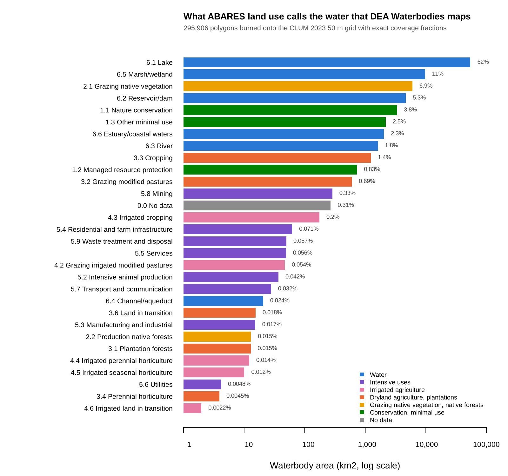
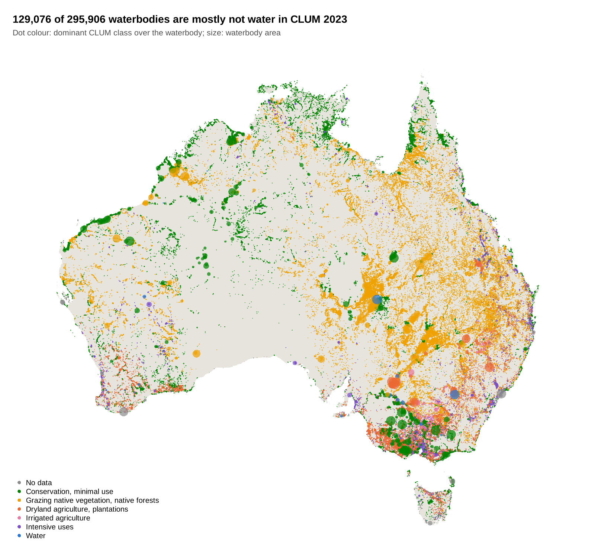

```{r setup, include = FALSE}
## The code here reads about 260 MB over the network and takes a few
## minutes, so it is not run when the site builds. The output shown is
## from a run on 2026-10-19 (controlledburn with the hole and wall-cell
## coverage fixes, R 4.3.3, GDAL 3.8.4, gdalraster 2.7.0).
knitr::opts_chunk$set(eval = FALSE, collapse = TRUE, comment = "#>")
```

This article burns a whole-of-Australia polygon set onto a
whole-of-Australia raster grid at full resolution, with exact coverage
fractions, then uses the sparse result for zonal statistics. Nothing dense
is allocated except small windows.

## The data

Both datasets are national, official and CC BY 4.0, and both are served
from Geoscience Australia's public Digital Earth Australia bucket, in
GDA94 / Australian Albers (EPSG:3577). GDAL reads each straight from its
URL: no download step, no portal and no reprojection.

* **Polygons**: [DEA Waterbodies](https://knowledge.dea.ga.gov.au/data/product/dea-waterbodies-landsat/)
  v1.1.0, 295,906 polygons, every waterbody wet often enough to map from
  the Landsat record. The vertices sit on a 25 m lattice.
* **Grid**: [ABARES Catchment Scale Land Use of Australia](https://doi.org/10.25814/2w2p-ph98),
  December 2023 update, 50 m. That is 80,200 x 75,987 cells, 6.1 billion
  in all, held as a cloud-optimised GeoTIFF of ALUM land use codes.

The question the pair asks: how much of the water that DEA maps from
satellites does ABARES land use call water (ALUM class 6), and what does
it call the rest?

```{r data}
library(controlledburn)
library(gdalraster)

dea <- "https://dea-public-data.s3.ap-southeast-2.amazonaws.com"
wb_dsn <- file.path("/vsizip//vsicurl", dea,
  "derivative/dea_waterbodies/1-1-0/shapefile/wb_c2_v1-1-0_prod.zip")
clum_dsn <- file.path("/vsicurl", dea, "projects/abares_clum_2023/clum_50m_2023.tiff")

## the grid: burn() only needs its extent and dimension
clum <- new(GDALRaster, clum_dsn)
bb <- clum$bbox()
ex <- c(bb[1], bb[3], bb[2], bb[4])          # xmin, xmax, ymin, ymax
dm <- c(clum$getRasterXSize(), clum$getRasterYSize())
```

## Read and burn

The polygons come in as WKB, which `burn()` takes directly.

```{r read}
system.time({
  lyr <- new(GDALVector, wb_dsn)
  lyr$returnGeomAs <- "WKB"
  wb <- lyr$fetch(-1)
})
#>    user  system elapsed
#>   7.009   0.260  24.550
```

Every polygon, at full resolution, with exact coverage fractions:

```{r burn}
system.time(
  r <- burn(wb$geom, extent = ex, dimension = dm)
)
#>    user  system elapsed
#>  14.311   0.377  14.803
r
#> <controlledburn> 80200 x 75987 grid, 295906 geometries
#>   runs:   4008460 (31753611 interior cells)
#>   edges:  6635728 polygon boundary cells
#>   sparsity: 99.4% empty
head(r$runs)    # row, col_start, col_end, id: whole cells
#>     row col_start col_end id
#> 1 56039      6990    6990  1
#> 2 56040      6991    6991  1
#> 3 55993      6953    6953  2
#> 4 55993      6954    6954  2
#> 5 55994      6953    6953  2
#> 6 55994      6954    6954  2
head(r$edges)   # row, col, fraction, id: boundary cells
#>     row  col fraction id
#> 1 56038 6990     0.75  1
#> 2 56038 6991     0.50  1
#> 3 56039 6991     0.75  1
#> 4 56040 6990     0.25  1
#> 5 56040 6992     0.50  1
#> 6 55992 6953     0.50  2
format(object.size(r), units = "MB")
#> [1] "187.7 Mb"
```

The result is about 190 MB. The same grid as dense doubles would be
49 GB, and 99.4% of it would be zero.

## Materialize a window

Only a window is ever made dense: here 20 km around Lake Hume, on the
NSW and Victoria border.

```{r window}
win <- c(1340000, 1360000, -4035000, -4015000)
cover <- materialize_chunk(r, target = win)          # coverage 0..1
dim(cover)
#> [1] 400 400
sub <- crop_burn(r, win)                             # its snapped grid
image(t(cover[nrow(cover):1, ]), asp = 1, axes = FALSE,
      col = hcl.colors(32, "Blues", rev = TRUE))
```

## Zonal statistics in the window

Read the same window of the land use grid and weight each class by
coverage. Each cell is 2,500 m2.

```{r zonal-window}
off <- (sub$extent[c(1, 4)] - ex[c(1, 4)]) / c(50, -50)
v <- clum$read(1L, off[1], off[2], sub$dimension[1], sub$dimension[2],
               sub$dimension[1], sub$dimension[2])
landuse <- matrix(v, nrow = sub$dimension[2], byrow = TRUE)
km2 <- tapply(cover, landuse, sum) * 2500 / 1e6       # km2 of water by ALUM code
round(sort(km2[km2 > 0.01], decreasing = TRUE), 2)
#>   620   610   630   117   320   650   210   542   582   114   420   553   572
#> 47.33 12.64  1.82  1.56  1.49  0.16  0.14  0.12  0.10  0.10  0.08  0.08  0.05
#>   622   111   550   530
#>  0.03  0.02  0.01  0.01
```

Lake Hume comes out as 47.3 km2 of reservoir/dam (ALUM 6.2, code 620)
and 12.6 km2 of lake (6.1). Per waterbody, `fun = "id"` labels each cell
with its polygon; where two waterbodies share a cell the last one wins,
so this is exact only where they do not.

```{r zonal-id}
id <- materialize_chunk(r, fun = "id", target = win)
z <- tapply(cover, list(uid = wb$uid[id], alum = landuse), sum) * 2500 / 1e6
round(z[order(-rowSums(z, na.rm = TRUE))[1:5], colSums(z, na.rm = TRUE) > 0.1], 2)
#>               alum
#> uid             117  210  320  542 582   610  620  630  650
#>   r38dsrnum_v1 1.27 0.04 0.51 0.06  NA 12.64 47.3 0.86 0.03
#>   r386x7pxe_v1 0.09 0.00 0.06   NA  NA    NA   NA 0.72   NA
#>   r38d8gben_v1   NA   NA 0.16 0.01  NA    NA   NA   NA   NA
#>   r38d8pw44_v1 0.02   NA 0.01   NA  NA    NA   NA 0.18   NA
#>   r38d9wws5_v1   NA   NA 0.18   NA  NA    NA   NA   NA   NA
```

## Zonal statistics for the whole country

The national tally never makes a dense window at all. It works through
the sparse tables one strip of COG block rows at a time, reads the land
use values only for the cells the burn touched (38.4 million of the 6.1
billion), and sums coverage by polygon and class.

```{r zonal-national}
blk <- clum$getBlockSize(1)[2]
strip_r <- (r$runs$row - 1L) %/% blk
strip_e <- (r$edges$row - 1L) %/% blk
strips <- sort(unique(c(strip_r, strip_e)))
runs <- split(r$runs, factor(strip_r, strips))
edges <- split(r$edges, factor(strip_e, strips))

expand_runs <- function(x) {
  n <- x$col_end - x$col_start + 1L
  i <- rep(seq_len(nrow(x)), n)
  data.frame(row = x$row[i], col = x$col_start[i] + sequence(n) - 1L,
             w = 1, id = x$id[i])
}

system.time({
  tally <- lapply(names(runs), function(s) {
    e <- edges[[s]]
    cells <- rbind(expand_runs(runs[[s]]),
                   data.frame(row = e$row, col = e$col, w = e$fraction, id = e$id))
    r0 <- min(cells$row); nr <- max(cells$row) - r0 + 1L
    c0 <- min(cells$col); nc <- max(cells$col) - c0 + 1L
    v <- clum$read(1L, c0 - 1L, r0 - 1L, nc, nr, nc, nr)
    code <- v[(cells$row - r0) * nc + (cells$col - c0) + 1L]
    code[is.na(code)] <- 0L
    rowsum(cells$w, cells$id * 1000 + code, reorder = FALSE)
  })
  tally <- do.call(rbind, tally)
  tally <- rowsum(tally, as.numeric(rownames(tally)))
})
## about 90 s over the network, 40 s from a local copy
key <- as.numeric(rownames(tally))
tab <- data.frame(id = key %/% 1000, code = key %% 1000, area_m2 = tally[, 1] * 2500)
```

Burned area matches the polygons' own `area_m2` attribute to 0.999978.
What is left of that difference is all in invalid polygons, rings that
cross or touch themselves; every valid polygon burns to its exact area.

Grouped by ALUM secondary class, 82.6% of DEA waterbody area is water in
CLUM: lakes 62%, marsh/wetland 11%, reservoir/dam 5.3%. The biggest
non-water class is grazing native vegetation at 6.9%, then nature
conservation at 3.8%.



By count, 129,076 of the 295,906 waterbodies are mostly not water in
CLUM. They are small (median 1.1 ha), 13,080 km2 in total: mostly
ephemeral water that CLUM labels by the land use around it.


